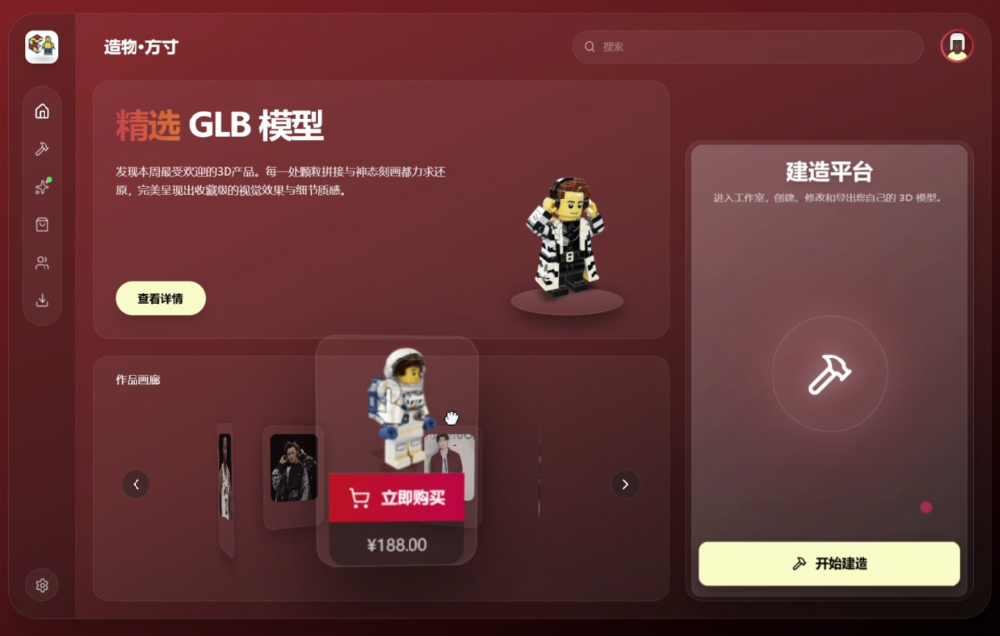
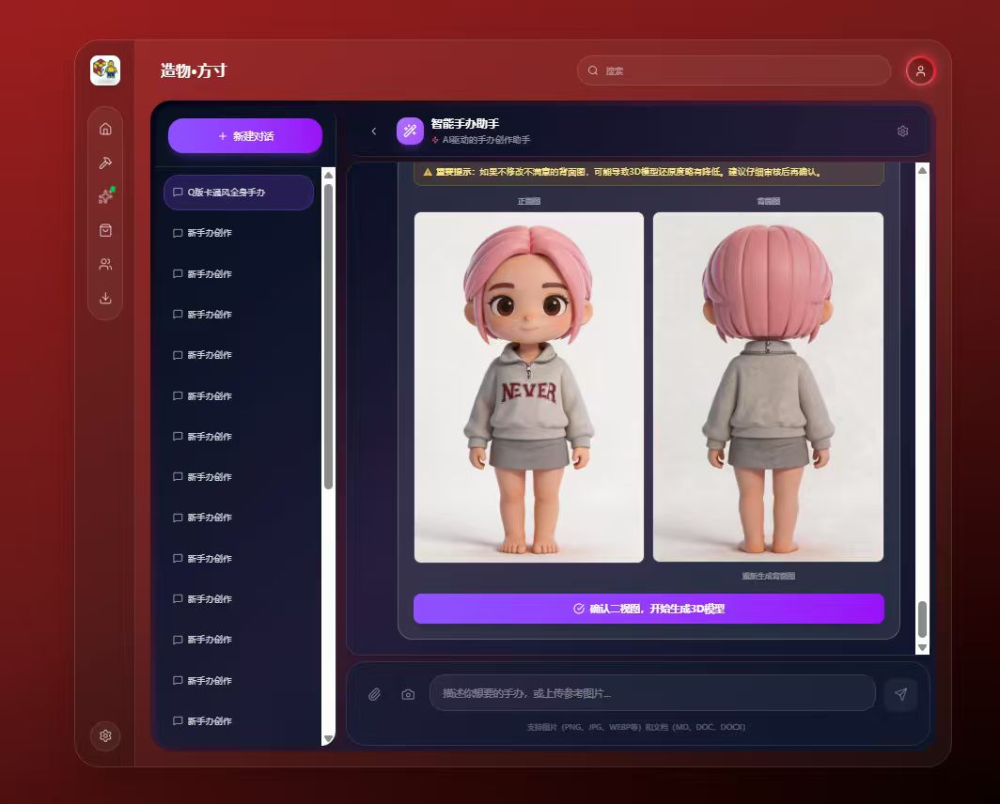
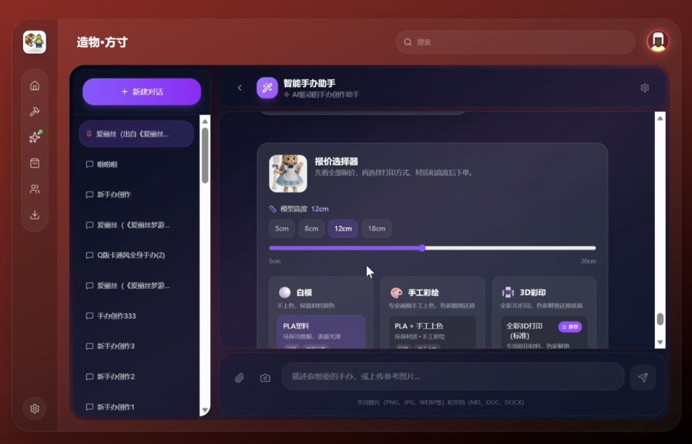
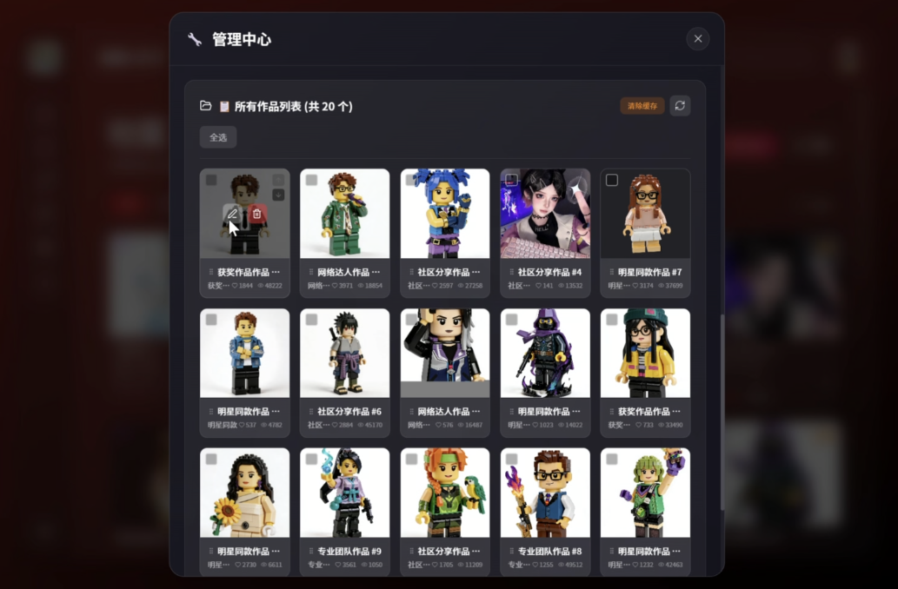
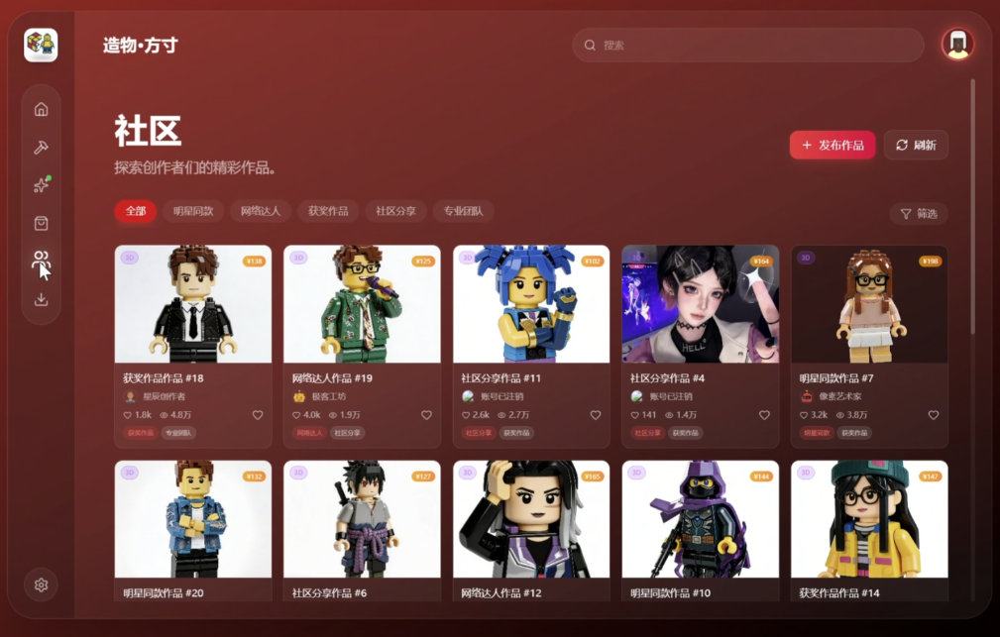
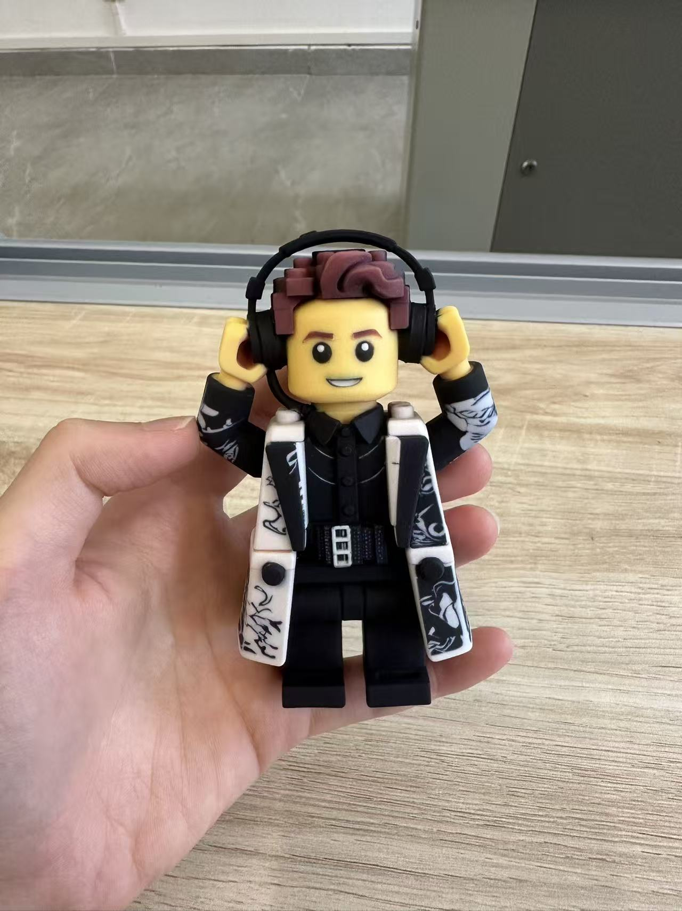

<div align="center">

# 造物·方寸

### 基于多模型 AI 协同的对话式 3D 手办生成平台

从一张照片与一次自然语言对话出发，完成需求理解、形象生成、3D 建模、材质推荐、智能估价与下单交付。

[](https://github.com/sweet11021101-png/Zaowu-Fangcun/releases/latest)

<br />



</div>

## 项目简介

造物·方寸面向个性化手办设计与制造场景，将传统依赖人工沟通、设计与建模的流程，转化为可对话、可回退、可校验的 AI 协作流程。用户可以上传参考照片，通过对话确定主体、风格、视角与制作方式，随后预览生成图和 3D 模型，并完成材质选择、估价与订单确认。

本仓库用于展示产品方案、交互效果与项目材料，当前不包含完整源代码。

## 核心体验

1. 上传照片或输入自然语言需求。
2. 智能体识别创作意图并收集必要参数。
3. 生成并迭代正面图、背面图或风格化效果。
4. 将确认后的图像转换为可预览的 GLB 3D 模型。
5. 根据尺寸、材质与制作工艺给出方案和价格参考。
6. 从购物车、地址确认到支付完成，形成产品体验闭环。

## 多模型协同架构

系统采用“主智能体协调 + 专用模型执行”的方式组织能力：

- **MiniMax**：负责对话理解、意图路由、任务规划与工具调用。
- **Seedream**：负责图像生成、局部修改与风格迁移。
- **腾讯混元 3D**：负责从确认后的图像生成 GLB 模型。
- **Google model-viewer**：负责浏览器中的 3D 模型预览与交互。

对话流程由多状态有限状态机管理，将非结构化需求转换为可控的生产步骤，并支持中断、回退、重做、超时处理和降级路径。

## RAG 与可靠性设计

项目使用混合检索 RAG，为材质、工艺、打印、涂装与价格相关问答提供知识支持：

- 语义向量检索与 BM25 关键词检索并行召回。
- 使用 RRF 融合与重排序，提高检索结果相关性。
- 语义优先分片，并提供离线检索降级能力。
- 通过提示词约束、来源追踪、规则检测和综合校验降低幻觉风险。
- 对不确定结论进行标记，并为关键步骤保留人工确认入口。

## 技术栈

| 层级 | 主要技术 |
| --- | --- |
| Web 前端 | React 19、TypeScript 5.8 |
| 服务端 | Node.js、Express 4 |
| 移动端 | Kotlin、Jetpack Compose |
| 3D 展示 | GLB、Google model-viewer |
| 数据与检索 | MySQL、JSON 降级存储、混合检索 RAG |
| AI 能力 | MiniMax、Seedream、腾讯混元 3D |

## 产品效果

<p align="center">
  
  
  
</p>

<p align="center">
  
  
</p>

## 项目测试记录

以下数据来自项目答辩材料中的测试记录，用于说明原型阶段的工程表现，不代表公开生产环境 SLA：

| 指标 | 项目记录 |
| --- | ---: |
| 首 Token 响应 | 约 1.8 秒 |
| RAG 检索响应 | 约 0.5 秒 |
| 4 张图像生成 | 约 13 秒 |
| 图像编辑 | 约 8 秒 |
| 3D 模型生成 | 约 460 秒 |
| GLB 文件大小 | 约 2.4 MB |
| 意图识别准确率 | 约 92% |

## 多端生态

项目同时设计了 Web 与 Android 端：Web 端承担专业创作、3D 预览与管理体验，移动端覆盖社区浏览、商城、订单与支付链路。两端围绕同一套创作与交易流程组织功能，为后续云端服务与多用户协作预留扩展空间。

## 路线图

- 从本地部署演进至云端服务与云数据库。
- 完善真实支付、订单与制造服务的系统集成。
- 引入更完整的约束、反馈与验证体系，持续优化智能体流程。
- 探索 Hermes Agent、Harness Engineering 与自动化运维反馈机制。

> 路线图内容为后续规划，不代表相关能力已全部投入生产使用。

## 仓库内容

```text
.
├── assets/screenshots/   # README 使用的匿名化安全效果图
├── docs/                 # 项目答辩 PPTX 与 PDF
└── README.md             # 项目介绍
```

完整演示视频因文件较大，存放在 [GitHub Releases](https://github.com/sweet11021101-png/Zaowu-Fangcun/releases/latest) 中。

